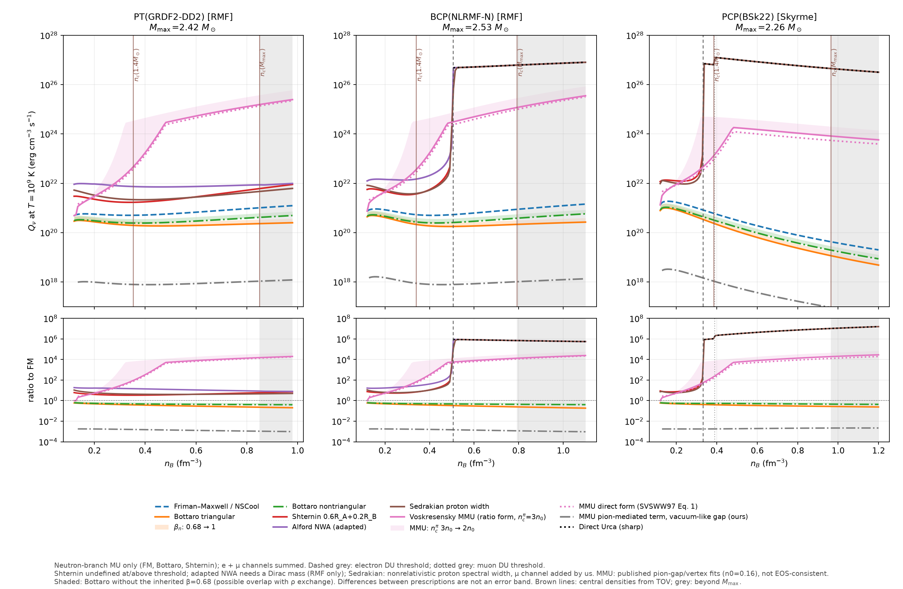

# Urca neutrino emission in neutron stars: theory comparison and multi-EOS numerics

Two deliberately separate tracks.

## 1. Theory reference (start here)

[`report/urca_physics_comparison.html`](report/urca_physics_comparison.html) — a self-contained, EOS-independent comparison of the physical ingredients of the original papers: Friman & Maxwell (1979), Bottaro et al. (2024), Shternin et al. (2018), Alford et al. (2024), Sedrakian (2024) and Voskresensky (2001, with Voskresenskiĭ & Senatorov 1986). A grouped matrix links to expandable, source-checked explanations, a bibliography and a list of source checks; block F opens a subproject on chiral-EFT currents and in-medium pions. Open the file in any browser; no build step.

Supporting documents:

* [`docs/THEORY_OPEN_QUESTIONS.md`](docs/THEORY_OPEN_QUESTIONS.md) — open-issue register (Q1: unsoftened intermediate-state currents; Q4: β<sub>n</sub> = 0.68 and its overlap with ρ exchange).
* [`docs/REFERENCES.md`](docs/REFERENCES.md) — references with DOIs and arXiv links.
* [`docs/VERIFICATION_LOG.md`](docs/VERIFICATION_LOG.md) — record of primary-source checks.

## 2. Numerical track: multi-EOS comparison

[`docs/NUMERICS.md`](docs/NUMERICS.md) describes the method, consistency choices, results and caveats. The code in [`numerics/`](numerics/) evaluates FM79/NSCool, Bottaro (triangular and nontriangular), Shternin, an adapted Alford width approximation, Sedrakian's proton spectral width, Voskresensky's medium-modified Urca (first-approximation parametrization) and the sharp direct Urca rate on one standardized cold npeμ state per density, for three CompOSE EOSs: PT(GRDF2-DD2), BCP(NLRMF-N) and BSk22.



```bash
python -m pip install -r requirements.txt
python -m numerics.run_compare --points 120     # writes results/ (~75 s)
python -m unittest discover -s tests -v         # 22 tests
```

The original CompOSE tables are not redistributed; derived extracts are in `numerics/data/`, and `tools/` regenerates them from downloads placed in `external_eos/` (gitignored).

## Layout

| Path | Contents |
|---|---|
| `report/urca_physics_comparison.html` | Master theory reference |
| `docs/` | Open questions, references, verification log, roadmap, numerical documentation |
| `numerics/` | EOS loaders, prescriptions, Sedrakian and MMU modules, TOV solver, scan runner, Bottaro spin–isospin validation |
| `numerics/data/` | Derived EOS inputs and the TOV cache |
| `results/` | CSV per EOS and figures |
| `tests/` | Regression, limit and convergence tests |
| `tools/` | CompOSE extraction scripts |

## Working rules

Read [`AGENTS.md`](AGENTS.md) (protocol for contributors and assistants) and [`CONTRIBUTING.md`](CONTRIBUTING.md). The theory HTML never contains EOS-specific numbers; the numerical track never presents adapted prescriptions as the original authors' results. This is a research prototype, not a validated cooling-microphysics library. No license has been selected yet.

Repository: [jpons19/urca-dd2-research](https://github.com/jpons19/urca-dd2-research).
